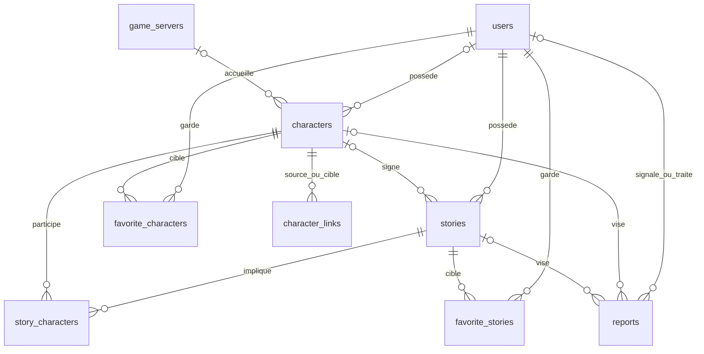

# Base de données

Schéma de conception, pas encore exécuté. Alembic fera foi une fois le backend créé.

| Table | Rôle | Clés et contraintes | À la suppression |
|---|---|---|---|
| users | compte privé | email unique sans casse | |
| game_servers | serveur de jeu | (game, name) unique | refusée s'il reste des personnages |
| characters | fiche publique | user_id et server_id, NULL pour un PNJ seulement | suit le compte |
| stories | histoire | user_id possède, character_id signe | suit le compte, survit au personnage |
| story_characters | personnages impliqués | PK (story_id, character_id) | suit les deux |
| favorite_characters | favori privé | PK (user_id, character_id) | suit les deux |
| favorite_stories | favori privé | PK (user_id, story_id) | suit les deux |
| character_links (V1.1) | source considère cible comme… | PK (source_id, target_id), source différente de cible | suit les deux |
| reports | signalement | une cible au plus, copie du contenu | survit à tout |

## Colonnes
- **users** : id, email, password_hash, role, email_verified_at, banned_at, created_at
- **game_servers** : id, game, name, is_active
- **characters** : id, user_id, server_id, is_npc, name, class, level, avatar, appearance, personality, backstory, goals, flaws, rumors, ooc_note, looking_for_rp, hidden_at, created_at, updated_at
- **stories** : id, user_id, character_id, title, body, published_at, hidden_at, created_at, updated_at
- **story_characters** : story_id, character_id, accepted_at, created_at
- **favorite_characters** : user_id, character_id, created_at
- **favorite_stories** : user_id, story_id, created_at
- **character_links** : source_id, target_id, label
- **reports** : id, reporter_id, reported_user_id, target_character_id, target_story_id, reason, snapshot, decision, handled_by, handled_at, created_at

## À traiter en V1.1
Séparer stories de story_parts, pour que supprimer un compte n'efface pas les suites des autres.
