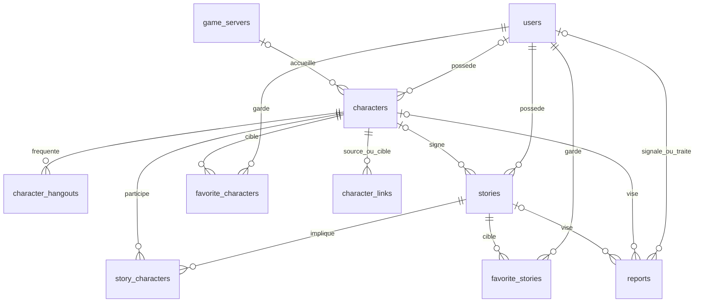

# Base de données

Schéma de conception, pas encore exécuté. Alembic fera foi une fois le backend créé.

| Table | Rôle | Clés et contraintes | À la suppression |
|---|---|---|---|
| users | compte privé | email unique sans casse | |
| game_servers | serveur de jeu | (game, name) unique | refusée s'il reste des personnages |
| characters | fiche publique | user_id et server_id, NULL pour un PNJ seulement | suit le compte |
| character_hangouts | lieu de prédilection | (character_id, area, x, y) unique, 3 par personnage | suit le personnage |
| stories | histoire | user_id possède, character_id signe | suit le compte, survit au personnage |
| story_characters (après V1) | personnages impliqués | PK (story_id, character_id) | suit les deux |
| favorite_characters (après V1) | favori privé | PK (user_id, character_id) | suit les deux |
| favorite_stories (après V1) | favori privé | PK (user_id, story_id) | suit les deux |
| character_links (après V1) | source considère cible comme… | PK (source_id, target_id), source différente de cible | suit les deux |
| reports | signalement | une cible au plus, copie du contenu | survit à tout |
| sessions | connexion ouverte | token_hash unique | suit le compte |
| email_tokens | lien envoyé par email | token_hash unique, purpose verify ou reset | suit le compte |
| login_failures | connexion ratée, pour limiter les essais | index sur email, ip et date | effacée à la connexion réussie |
| throttle_events | action limitée (inscription, renvoi d'email) | index sur la date | |

## Colonnes
- **users** : id, email, password_hash, role, email_verified_at, banned_at, created_at
- **game_servers** : id, game, name, is_active
- **characters** : id, user_id, server_id, is_npc, name, gender, ingame_name, class, level, avatar, seal, hook, appearance, personality, backstory, goals, flaws, rumors, ooc_note, play_days, play_periods, inactive_at, inactive_note, hidden_at, created_at, updated_at
- **character_hangouts** : id, character_id, area, x, y, label, habits
- **stories** : id, user_id, character_id, title, body, published_at, hidden_at, created_at, updated_at
- **story_characters** : story_id, character_id, accepted_at, created_at
- **favorite_characters** : user_id, character_id, created_at
- **favorite_stories** : user_id, story_id, created_at
- **character_links** : source_id, target_id, label
- **sessions** : id, user_id, token_hash, created_at, last_seen_at, expires_at
- **login_failures** : id, email, ip, created_at
- **throttle_events** : id, action, key, created_at
- **email_tokens** : id, user_id, purpose, token_hash, expires_at, used_at, created_at
- **reports** : id, reporter_id, reported_user_id, target_character_id, target_story_id, reason, snapshot, decision, handled_by, handled_at, created_at

## Retrouver un personnage en jeu
Tous ces champs sont facultatifs.
- `play_days` : `smallint[]`, de 1 (lundi) à 7.
- `play_periods` : `text[]` parmi morning (6-12h), afternoon (12-18h), evening (18-00h), night (00-6h), heure de Paris.
- `inactive_at` : NULL si le personnage est actif. `inactive_note` peut donner une raison RP.
- `area` distingue des coordonnées identiques dans deux mondes.
- La limite de trois lieux est vérifiée par le back.

## Présentation d'un personnage
- `gender` : genre grammatical, `feminine`, `masculine` ou `neutral` par défaut. Il ne sert qu'à accorder les textes du site, les pronoms se précisent dans la fiche.
- `hook` : la réplique d'accroche, ce que le personnage répond quand on l'aborde.
- `class` : une classe du jeu, en identifiant (`cra`, `xelor`…), ou NULL. Le nom affiché vit dans le frontend.
- `seal` : sceau prédéfini, forme et couleur de cire, comme l'avatar.

## Avant les histoires à plusieurs mains
Séparer stories de story_parts, pour que supprimer un compte n'efface pas les suites des autres.
